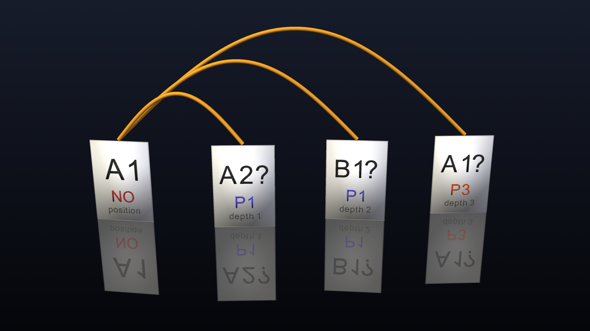
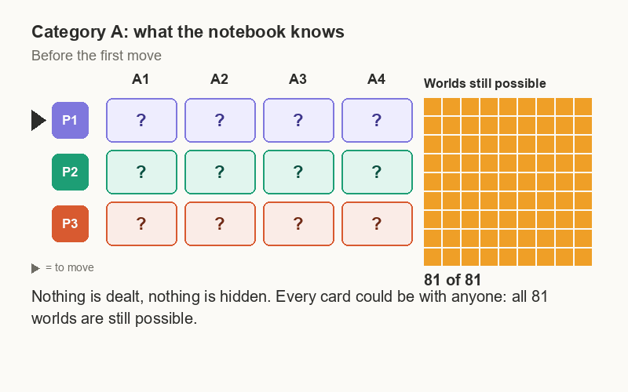
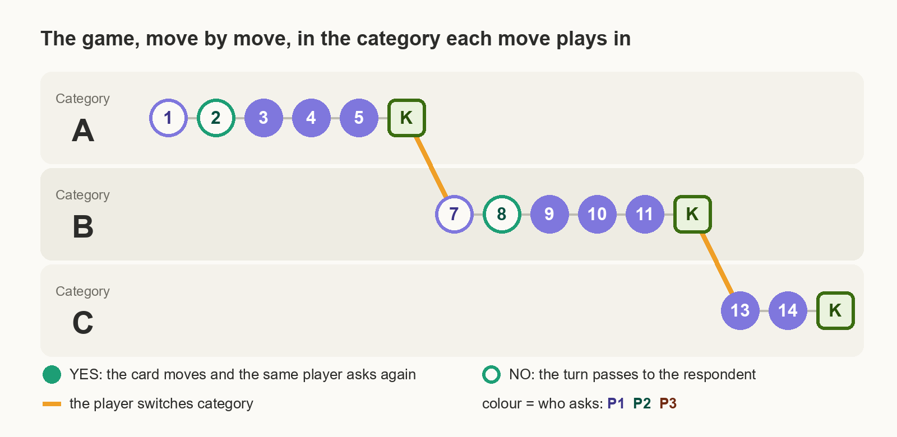

# Teaching a Computer to Play Blind Kwartet — and Watching It Get Confused

*An exact local solver plays surprisingly well. Then deeper search starts changing its mind.*

> Caption: **Feature image: the same position after two public events. A search one, two or three exchanges deep asks three different questions.**
> Alt text: Three arrows leave one and the same game position. Each is labelled with a search depth, and each ends at a different question: P1 for A2, P1 for B1, and P3 for A1.
> Source: Image by author.
<!-- TODO (Rob): alt text assumes the feature image is the depth 1/2/3 fork at the 9,032-world position. Adjust if the final image is different. -->

## From Referee to Player

**Goal:** Reconnect to Post 1. We already built a referee that can tell whether a game state and move are legal. Now we ask the natural next question: can that same exact public-state model be used to choose good moves?

Introduce the strategic state at a high level without re-deriving the full referee. Emphasize that there is no hidden true deal: the player reasons over all deals still compatible with the public history.

Set up the central promise of the post: strategy sounds like “just search the game tree,” but that quickly becomes more interesting than expected.

## The Obvious Idea: Search the Whole Tree

**Goal:** Start with the most straightforward strategy and let it fail naturally.

Explain that every legal question can branch into YES and NO, each of those creates a new exact public state, and the process can be repeated recursively.

Show the first branching numbers and make the explosion concrete. The purpose is not yet to optimize it, but to establish why brute-force global search is not a satisfying first solution.

Also introduce the first source of fake complexity: many branches differ only because currently unnamed cards or categories carry arbitrary internal labels.

## Removing Branches That Do Not Really Differ

**Goal:** Show that some of the tree explosion is bookkeeping rather than strategy.

Explain the semantic naming idea: public names are created by first mention, so two moves that differ only by unused hidden labels can be strategically equivalent.

Introduce semantic move pruning as a way to keep one representative from each naming-equivalent class while leaving the exact referee untouched.

Use the dramatic reduction in branching as evidence that naming symmetry matters.

End the section with the key transition: even after pruning, full global search is still expensive enough that we need a more structural idea.

## What If We Solve Just One Category?

**Goal:** Introduce the exact 81-world single-category solver as the first major simplification.

For one category, four cards and three players give only \(3^4 = 81\) current ownership worlds.

Explain the local game in intuitive terms:
- a legal ask;
- YES transfers the named card and keeps the turn;
- NO passes the turn to the respondent;
- a completed quartet ends the local contest;
- recursion can be solved exactly.

Introduce the three outcomes:
- WIN;
- OPEN;
- LOSS.

The important message is that this is not a heuristic. Within one category, it is exact.

> Caption: **Figure 1: One category, as the notebook sees it (animated). Each cell asks whether a player could hold a card right now, and the 81 squares are the possible ownerships. Every answer switches off the worlds it contradicts, down to the single world left when P3 announces Kwartet. Nothing was dealt in advance; the table only records what has been said.**
> Alt text: An animation of a table with rows P1, P2 and P3 and columns A1 to A4, next to a nine by nine grid of 81 squares. Each cell shows a question mark, a cross or the word holds. As the game goes on, the lit squares shrink from 81 to one, and P3 ends up holding all four cards.
> Source: Animation by author.

## A Surprisingly Strong Local Player

**Goal:** Turn the single-category solver into a real player and create a moment of success.

Explain that the player examines every legal question, projects that category into the 81-world local model, and prefers WIN over OPEN over LOSS.

Across categories it chooses the best local outcome and breaks ties deterministically.

Present the empirical surprise: this simple local player already performs very well.

This should feel like the apparent breakthrough in the story: perhaps the hard global problem can be sidestepped by solving the local pieces exactly.

> Caption: **Figure 2: The local player. Each category is handed on its own to the single-category solver, which labels every legal question WIN, OPEN or LOSS. The player takes the best label over all categories and breaks ties by a fixed rule. No category knows anything about the others.**
> Alt text: Three columns for the categories A, B and C. Each lists a few candidate questions with a WIN, OPEN or LOSS label. One arrow from the best question in each column leads to a single chosen question.
> Source: Image by author.
<!-- TODO (Rob): check the alt text against the final figure. -->

## The Catch: Categories Interact

**Goal:** Break the apparent solution and explain why local optimality is not global optimality.

Give intuitive examples:
- chasing A may hand the turn to someone ready to complete B;
- switching category may be strategically valuable;
- a locally winning line can create a globally bad tempo;
- information learned in one category can alter what is possible in another.

Make clear that this is where Blind Kwartet stops decomposing cleanly into independent subgames.

This is the conceptual reason we need some global lookahead.

## A Hybrid Strategy

**Goal:** Introduce the current search architecture as the natural compromise.

Describe the hybrid:
- exact global state at the top;
- semantic move pruning;
- shallow global lookahead across full legal questions and strategic answers;
- exact single-category solver at the leaves.

Frame it as “global tree outside, exact local solver inside.”

Explain why this is attractive: we spend expensive global search only where category interaction matters, while preserving exact local tactical knowledge at the horizon.

> Caption: **Figure 3: The tree player. The top of the tree is the real game, with all categories, expanded by whole question-and-answer exchanges down to a fixed depth. At the horizon, the exact single-category solver judges each leaf, so everything below the horizon is replaced by that local verdict.**
> Alt text: A tree with the full game at its root. It branches into questions and then YES and NO answers for a few levels. The bottom row of leaves carries a label for the single-category solver.
> Source: Image by author.
<!-- TODO (Rob): check the alt text against the final figure. -->

## Looking Further Ahead Changes Its Mind

**Goal:** Deliver the central strategic surprise of the post.

Compare the behavior of local / depth 1 / depth 2 / depth 3 search.

Use concrete examples where:
- depth 1 agrees with the local player;
- depth 2 chooses something very different;
- depth 3 changes back or chooses a third option.

Introduce horizon effects carefully. Do not claim that deeper is automatically better or worse; show that shallow search can oscillate because the leaf evaluator sees different partial futures at different depths.

Use the complete-game outcomes as a vivid illustration that different search depths can produce qualitatively different games.

## So Which Player Is Actually Smarter?

**Goal:** Interpret the results without overclaiming.

Explain that in a three-player, non-zero-sum game, “better” is not a simple scalar property.

Each actor optimizes its own outcome, deeper search can expose new tactical opportunities for different players, and the final score depends on the full interaction.

Frame the unresolved research question:
- does search converge with depth?
- are we seeing odd/even horizon effects?
- is the local leaf evaluation the limiting factor?
- when does global search meaningfully outperform the exact local strategy?

Mention that depth 4 is the next experiment rather than presenting a conclusion prematurely.

## Letting a Human Try

**Goal:** Turn the strategy work into something tangible and playful.

Introduce the browser version as a deliberately minimal challenge:
- no hidden debug information;
- only public history;
- when it is the human’s turn, show only legal move buttons;
- when the human must answer, show only legal YES/NO choices;
- AI moves advance automatically at about one second per move.

The AI opponents use the single-category strategy.

Frame the invitation simply: can a human exploit the fact that the computer thinks locally?

## From Search Tree to Table Game

**Goal:** Close the story on a broader idea rather than on optimization details.

Return to the emotional arc:
- first the tree looked impossible;
- then one exact local solver seemed to solve the problem;
- then global interaction made the player “confused” again.

Emphasize that this confusion is useful. It reveals where local intelligence stops being enough and where strategic interaction begins.

End with a forward-looking bridge:
- deeper search;
- eventual memoization;
- exact multiverse versus compressed notebook state;
- and possibly richer table conversation later, while keeping the referee and strategy engine authoritative.

The final feeling should be that Blind Kwartet has become a compact laboratory for reasoning, search, symmetry, and horizon effects—not just a card game.
